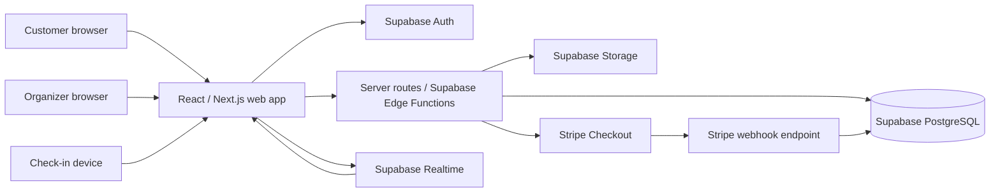
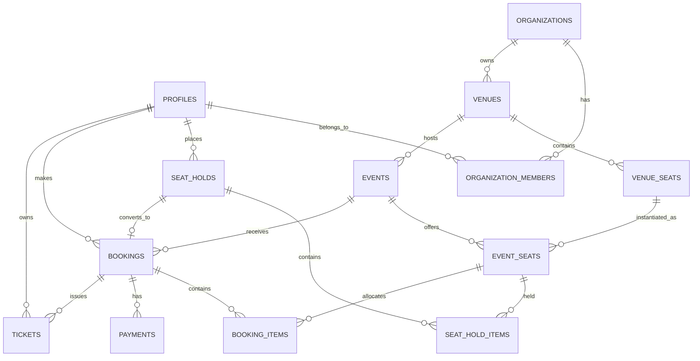

# Flow Design and Database Architecture

## 1. Project overview

SeatFlow is a focused event ticketing application. Customers discover events, select seats, reserve them briefly, pay online, and receive QR-code tickets. Organizers manage events and review bookings; staff can validate tickets at the door.

The first version is designed around the core booking journey rather than social features, subscriptions, or complex marketplace payouts.

### Main user roles

- **Customer:** browses events, reserves seats, pays, and views tickets.
- **Organizer:** manages venues, events, prices, and bookings for their organization.
- **Check-in staff:** validates QR tickets for assigned events.
- **Platform administrator:** manages platform-wide support and moderation tasks.

## 2. Architecture at a glance

### Responsibilities

| Component | Responsibility |
|---|---|
| React / Next.js | Event pages, seat map, checkout status, organizer dashboard, ticket display, check-in UI |
| Supabase Auth | Customer and staff authentication; identity attached to database requests |
| PostgreSQL | Source of truth for users, organizations, venues, events, inventory, holds, bookings, payments, and tickets |
| Supabase Realtime | Broadcast availability changes to event pages; it is a UX update channel, not the final inventory lock |
| Supabase Storage | Event images and optional venue assets; keep private files private and use signed URLs where needed |
| Server routes / Edge Functions | Trusted operations: hold seats, create Checkout Sessions, handle webhooks, issue QR tokens, scan tickets |
| Stripe Checkout | Hosted payment collection and payment status |
| Stripe webhooks | Verified asynchronous payment notifications that finalize bookings |

All secrets (Stripe secret key, webhook signing secret, Supabase service-role key) stay on the server. The browser must never receive them.

## 3. Key design decisions

1. **The database is authoritative for seat availability.** Realtime messages improve responsiveness, but every seat hold is revalidated and written transactionally in PostgreSQL.
2. **A seat is unique per event.** A venue seat can be reused across events, so inventory is modeled as an event-specific seat instance.
3. **Payment success is finalized by a verified webhook.** A browser redirect is not proof of payment.
4. **Seat holds expire.** A short hold (for example, 10 minutes) prevents abandoned checkouts from blocking inventory indefinitely.
5. **Ticket QR codes contain opaque random tokens.** Do not encode customer details or trust a client-generated ticket ID as proof of validity.
6. **Money is stored in integer minor units.** For example, store USD $25.00 as `2500`; never use floating-point values for payment totals.

## 4. Core booking flow

### A. Browse and select

1. Customer opens the event listing and filters by date, location, or category.
2. Event detail loads published event information and seat availability.
3. The browser subscribes to availability updates for that event.
4. Customer selects seats. The UI may show selections locally, but they are not reserved until the server confirms the hold.

### B. Place a temporary hold

1. The signed-in customer sends the event ID and requested event-seat IDs to a server endpoint.
2. The server validates the event is on sale, the requested seats belong to the event, and the seat count is within limits.
3. In one database transaction, the server locks the requested inventory rows in a consistent order, checks that each seat is available (or has an expired hold), and creates a hold with an expiration time.
4. If any seat is unavailable, the transaction fails as a whole; the customer is asked to choose again.
5. The server returns the hold ID and expiration timestamp. Other browsers receive an availability update.

### C. Take payment

1. The browser asks the server to create checkout for the hold.
2. The server rechecks that the hold belongs to the customer, is unexpired, and still covers the requested seats.
3. The server calculates the amount from database prices, creates a pending booking, then creates a Stripe Checkout Session with the booking/hold identifiers in metadata.
4. The server stores the Stripe Session ID and returns the hosted Checkout URL.
5. The customer completes or cancels payment on Stripe.

### D. Confirm and issue tickets

1. Stripe sends an event to the webhook endpoint.
2. The endpoint verifies the Stripe signature using the raw request body.
3. The handler processes events idempotently using the Stripe event ID. Replayed webhooks must not create duplicate tickets.
4. For a successful payment, one transaction marks the payment and booking paid, converts the held inventory to sold, and creates one ticket per seat with a cryptographically random QR token.
5. The customer can view the confirmed booking and tickets. The success redirect can poll for confirmation while the webhook is processing.
6. For failure, expiration, or cancellation, mark the attempt accordingly and release the hold when appropriate.

### E. Check in

1. Staff authenticates and opens an event check-in screen.
2. The scanner sends the QR token to a server endpoint.
3. The server verifies the token maps to a paid ticket for an event the staff member can access, and atomically changes `issued` to `used`.
4. Repeated scans return “already used”; invalid, refunded, or cancelled tickets are rejected.

## 5. Preventing double booking

Use a database function (PostgreSQL RPC) or server-side transaction for `create_seat_hold`. It should:

- Lock event-seat rows with `SELECT ... FOR UPDATE` (or an equivalent conditional update).
- Sort requested seat IDs before locking to reduce deadlock risk.
- Treat a seat as unavailable when it is sold or has a non-expired active hold.
- Insert all hold-seat rows only if every requested seat is available.
- Enforce uniqueness so one event-seat cannot have two active holds or two sold allocations.
- Expire holds using both a scheduled cleanup task and request-time checks. Correctness must not depend on the cleanup job running on time.

One practical model is to keep `event_seats` as inventory and represent its state with `status`, `held_until`, and `hold_id`. The transaction updates only rows that are available or whose existing hold has expired. A conditional update plus checking the affected row count provides a strong concurrency guard.

Realtime is not a lock: two customers may see a seat as available at the same moment. The transactional hold endpoint decides who gets it.

## 6. Database model

The schema below is a logical model. Implement constraints, indexes, RLS, and transactional operations in Supabase migrations. UUIDs are suitable for public identifiers; never treat an unguessable ID as authorization.

### Entity relationships

### Tables

#### `profiles`

Application profile linked to Supabase Auth.

| Column | Type | Notes |
|---|---|---|
| `id` | `uuid` PK | Same value as `auth.users.id` |
| `display_name` | `text` | Optional |
| `created_at` | `timestamptz` | Default `now()` |

Do not duplicate passwords or authentication secrets here.

#### `organizations`

Organizer account/business.

| Column | Type | Notes |
|---|---|---|
| `id` | `uuid` PK | |
| `name` | `text` | Public organizer name |
| `slug` | `text` unique | URL-friendly identifier |
| `created_at` | `timestamptz` | |

#### `organization_members`

Maps users to organizer workspaces.

| Column | Type | Notes |
|---|---|---|
| `organization_id` | `uuid` FK | `organizations.id` |
| `user_id` | `uuid` FK | `profiles.id` |
| `role` | `text` | `owner`, `manager`, or `checkin_staff` |
| `created_at` | `timestamptz` | |

Primary key: (`organization_id`, `user_id`). Use membership checks in RLS policies and server operations.

#### `venues`

Physical or virtual location managed by an organization.

| Column | Type | Notes |
|---|---|---|
| `id` | `uuid` PK | |
| `organization_id` | `uuid` FK | Owner organization |
| `name` | `text` | |
| `address` | `text` nullable | |
| `timezone` | `text` | IANA timezone, e.g. `Asia/Kolkata` |
| `created_at` | `timestamptz` | |

#### `venue_seats`

Reusable seat definitions for a venue. General-admission venues can use a section or capacity model instead of individual seats in a later iteration.

| Column | Type | Notes |
|---|---|---|
| `id` | `uuid` PK | |
| `venue_id` | `uuid` FK | |
| `section` | `text` | e.g. `Balcony` |
| `row_label` | `text` nullable | |
| `seat_label` | `text` | e.g. `A-12` |
| `map_x`, `map_y` | `numeric` nullable | Coordinates for simple seat-map rendering |
| `created_at` | `timestamptz` | |

Unique constraint: (`venue_id`, `section`, `row_label`, `seat_label`).

#### `events`

An event listing and its sale window.

| Column | Type | Notes |
|---|---|---|
| `id` | `uuid` PK | |
| `organization_id` | `uuid` FK | Organizer |
| `venue_id` | `uuid` FK | |
| `title` | `text` | |
| `slug` | `text` | Unique or unique within organizer |
| `description` | `text` | |
| `category` | `text` nullable | |
| `starts_at`, `ends_at` | `timestamptz` | Store instants in UTC; display in venue timezone |
| `sales_start_at`, `sales_end_at` | `timestamptz` nullable | |
| `status` | `text` | `draft`, `published`, `cancelled`, `completed` |
| `cover_image_path` | `text` nullable | Supabase Storage object path |
| `created_at`, `updated_at` | `timestamptz` | |

#### `event_seats`

Inventory for a particular seat at a particular event. Copy labels/section from the venue seat or reference it and snapshot display details if the layout may change after publishing.

| Column | Type | Notes |
|---|---|---|
| `id` | `uuid` PK | Event-specific seat ID |
| `event_id` | `uuid` FK | |
| `venue_seat_id` | `uuid` FK | Source venue seat |
| `section`, `row_label`, `seat_label` | `text` | Snapshot for stable ticket display |
| `price_id` | `uuid` FK nullable | Current price tier |
| `price_amount` | `integer` | Snapshot in minor units |
| `currency` | `char(3)` | ISO currency code |
| `status` | `text` | `available`, `held`, `sold`, `blocked` |
| `hold_id` | `uuid` nullable | Active hold, if held |
| `held_until` | `timestamptz` nullable | Hold expiration |
| `created_at` | `timestamptz` | |

Unique constraint: (`event_id`, `venue_seat_id`). Index (`event_id`, `status`) and (`hold_id`). Keep state transitions server-controlled.

#### `ticket_prices`

Named ticket price tiers. The event-seat price snapshot protects existing bookings if an organizer later edits a tier.

| Column | Type | Notes |
|---|---|---|
| `id` | `uuid` PK | |
| `event_id` | `uuid` FK | |
| `name` | `text` | e.g. `Standard` |
| `amount` | `integer` | Minor currency units |
| `currency` | `char(3)` | |
| `sales_start_at`, `sales_end_at` | `timestamptz` nullable | |
| `created_at` | `timestamptz` | |

#### `seat_holds`

Temporary reservation header.

| Column | Type | Notes |
|---|---|---|
| `id` | `uuid` PK | |
| `event_id` | `uuid` FK | |
| `user_id` | `uuid` FK | Customer |
| `status` | `text` | `active`, `converted`, `expired`, `released` |
| `expires_at` | `timestamptz` | |
| `created_at` | `timestamptz` | |

Index (`status`, `expires_at`) for cleanup.

#### `seat_hold_items`

Seats in a hold. This table helps preserve an audit trail. Use a unique constraint on `event_seat_id` for active allocation via the inventory row/transaction logic; ordinary uniqueness across historical expired holds is not appropriate.

| Column | Type | Notes |
|---|---|---|
| `hold_id` | `uuid` FK | |
| `event_seat_id` | `uuid` FK | |
| `unit_amount` | `integer` | Price snapshot at hold time |
| `currency` | `char(3)` | |

Primary key: (`hold_id`, `event_seat_id`).

#### `bookings`

Order header created for a customer.

| Column | Type | Notes |
|---|---|---|
| `id` | `uuid` PK | |
| `public_reference` | `text` unique | Short support-friendly reference |
| `event_id` | `uuid` FK | |
| `user_id` | `uuid` FK | |
| `hold_id` | `uuid` FK unique | One booking per hold |
| `status` | `text` | `pending_payment`, `paid`, `expired`, `cancelled`, `refunded` |
| `subtotal_amount`, `fee_amount`, `total_amount` | `integer` | Minor units |
| `currency` | `char(3)` | |
| `created_at`, `updated_at` | `timestamptz` | |

#### `booking_items`

One allocation per seat/ticket purchased.

| Column | Type | Notes |
|---|---|---|
| `id` | `uuid` PK | |
| `booking_id` | `uuid` FK | |
| `event_seat_id` | `uuid` FK | |
| `description_snapshot` | `text` | Seat label/section at purchase |
| `unit_amount` | `integer` | Paid price snapshot |
| `currency` | `char(3)` | |

Unique constraint: (`booking_id`, `event_seat_id`). Ensure a seat cannot belong to multiple active paid bookings through the finalize transaction and inventory state.

#### `payments`

Payment attempts and provider references.

| Column | Type | Notes |
|---|---|---|
| `id` | `uuid` PK | |
| `booking_id` | `uuid` FK | |
| `provider` | `text` | `stripe` |
| `stripe_checkout_session_id` | `text` unique nullable | |
| `stripe_payment_intent_id` | `text` unique nullable | |
| `status` | `text` | `created`, `pending`, `succeeded`, `failed`, `refunded` |
| `amount` | `integer` | Expected amount |
| `currency` | `char(3)` | |
| `created_at`, `updated_at` | `timestamptz` | |

Never store card numbers or CVC values.

#### `stripe_webhook_events`

Idempotency ledger for Stripe webhook deliveries.

| Column | Type | Notes |
|---|---|---|
| `stripe_event_id` | `text` PK | Stripe event ID |
| `event_type` | `text` | |
| `processed_at` | `timestamptz` nullable | Null until successfully handled |
| `created_at` | `timestamptz` | |

Insert or claim the event and apply its database changes in a transaction. If processing fails, allow a safe retry.

#### `tickets`

One scan-ready ticket per booking item.

| Column | Type | Notes |
|---|---|---|
| `id` | `uuid` PK | Internal ID |
| `booking_item_id` | `uuid` FK unique | One ticket per item |
| `event_id` | `uuid` FK | For efficient check-in authorization |
| `owner_user_id` | `uuid` FK | Customer |
| `qr_token_hash` | `text` unique | Store a hash of the random token when feasible |
| `status` | `text` | `issued`, `used`, `cancelled`, `refunded` |
| `used_at` | `timestamptz` nullable | |
| `created_at` | `timestamptz` | |

The QR image can be generated on demand from a token URL or rendered in the client from a server-provided token. Avoid storing the QR image itself unless a concrete need arises.

#### `event_checkin_staff` (optional if using organization roles only)

For event-specific staff assignment, use (`event_id`, `user_id`) with a role and created timestamp. This avoids granting check-in access to every event in an organization.

## 7. API and server operations

Suggested endpoints (names are illustrative):

| Operation | Auth | Purpose |
|---|---|---|
| `GET /events` | Public | Published events with pagination and filters |
| `GET /events/:slug` | Public | Event details and seat map/availability |
| `POST /holds` | Customer | Atomically reserve requested seats |
| `DELETE /holds/:id` | Hold owner | Release a hold early |
| `POST /checkout` | Customer | Validate hold, create booking/payment and Stripe Session |
| `POST /webhooks/stripe` | Stripe signature | Finalize or fail payment idempotently |
| `GET /me/bookings` | Customer | Customer booking history |
| `GET /me/tickets/:id` | Ticket owner | Ticket details and QR payload |
| `POST /checkin/scan` | Authorized staff | Validate and consume a QR token atomically |
| `POST /organizer/events` | Organizer member | Create event |
| `PATCH /organizer/events/:id` | Organizer member | Update authorized event |
| `GET /organizer/events/:id/bookings` | Organizer member | Paginated booking management |

Validate input on the server, calculate prices from trusted database records, and apply rate limits to hold creation, checkout creation, and ticket scanning.

## 8. RLS and security model

Enable Row Level Security on all tables exposed through Supabase's API.

- **Public reads:** only published event details, public venue details, and non-sensitive available-seat data.
- **Customers:** read their own profiles, holds, bookings, and tickets. Never let clients directly mark a booking paid or a ticket used.
- **Organizers:** read and edit rows only when they have a suitable `organization_members` role for the owning organization.
- **Check-in staff:** only validate tickets for assigned events; do not expose customer payment details.
- **Writes to sensitive state:** perform via narrowly scoped server functions or PostgreSQL functions with explicit authorization checks.
- **Service role:** use only in trusted server runtime; it bypasses RLS and must not be sent to browsers.
- **Storage:** public event artwork may use a public read bucket; uploads should be restricted to authorized organizers and checked for size/type. Keep private exports private.

RLS is a second layer of protection. Server routes must still validate ownership, event state, and business rules.

## 9. Stripe payment model

For the initial portfolio implementation, charge the customer through Stripe Checkout for the platform and record the payment against the booking. Decide the payout model explicitly before production:

- **Platform sells tickets:** platform is merchant of record and pays organizers separately; account for refund, tax, and chargeback responsibility.
- **Stripe Connect:** organizers onboard Express accounts and receive transfers. This is useful if organizers are paid through the platform, but adds onboarding, capabilities, account status, and transfer failure handling.

Do not claim the platform's 80/20 split is implemented unless Connect account onboarding, application fees, transfers, refunds, and relevant webhook states are handled. For a portfolio MVP, one Stripe test-mode payment flow is enough to demonstrate booking integration.

Webhook handling should verify signature, validate metadata against stored booking/payment rows, compare amount and currency, and support at least successful, expired, and failed checkout outcomes. Use Stripe idempotency keys when creating sessions to reduce duplicate session creation.

## 10. Indexes and constraints to prioritize

- Unique `events.slug` (or (`organization_id`, `slug`)).
- Unique (`venue_id`, seat identifiers) on `venue_seats`.
- Unique (`event_id`, `venue_seat_id`) on `event_seats`.
- Index `events(status, starts_at)` for public browsing.
- Index `event_seats(event_id, status)` for event seat-map queries.
- Index `seat_holds(status, expires_at)` for expiration sweeps.
- Unique Stripe session and payment intent IDs when present.
- Index `bookings(user_id, created_at DESC)` for customer history.
- Index `bookings(event_id, status)` for organizer views.
- Unique `tickets.qr_token_hash`; index (`event_id`, `status`) for check-in counts.
- Use foreign keys and `CHECK` constraints for positive prices, valid status values, and `ends_at > starts_at` where appropriate.

## 11. Deployment and operations

- Host the web app on Netlify or Vercel; use serverless routes/functions for trusted operations.
- Create separate Supabase projects for development and production.
- Store secrets in the host's environment settings and rotate them if exposed.
- Apply database changes through versioned Supabase migrations.
- Configure Stripe webhook endpoints separately for test and live modes.
- Log booking reference, payment IDs, webhook event IDs, and failures; never log secret keys or full payment credentials.
- Add a scheduled job to release expired holds and alert on repeated webhook failures.
- Back up the production database and define a basic refund/support procedure before accepting real payments.

## 12. Build sequence for a portfolio MVP

1. Create Supabase project, migrations, Auth, sample organization, venue, seats, and event.
2. Build public event list and event detail pages.
3. Build seat map and the transactional seat-hold function; confirm concurrent requests cannot reserve the same seat.
4. Add booking creation and Stripe Checkout in test mode.
5. Add signature-verified, idempotent webhooks and ticket issuance.
6. Add customer booking/ticket pages and QR scanning check-in.
7. Add organizer event and booking management with RLS.
8. Polish responsive design, loading/error states, demo seed data, and a README with architecture and test-mode demo steps.

## 13. MVP completion criteria

- A visitor can find a published event and inspect its details.
- Two concurrent customers cannot successfully hold the same seat.
- A hold expires and makes seats available again.
- Successful Stripe test payment creates exactly one paid booking and one ticket per seat.
- Duplicate webhook delivery does not duplicate tickets or payments.
- Failed, expired, or abandoned checkout does not leave seats permanently blocked.
- A customer can access only their own bookings and tickets.
- An organizer can manage only their organization's events and see its bookings.
- Authorized staff can scan a valid ticket once; repeat scans are rejected.

